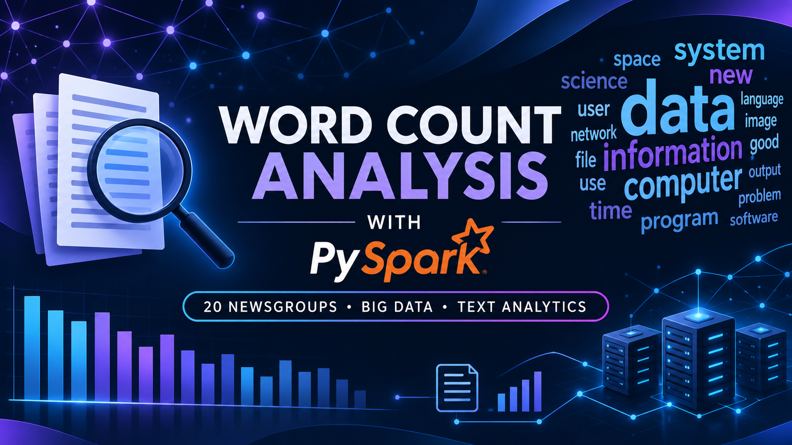

# Word Count Analysis with PySpark

A distributed text-processing project that uses **Apache Spark (PySpark)** to calculate word frequencies in the **20 Newsgroups** text dataset and visualize the results with Python.

## Project Overview

This notebook retrieves the complete 20 Newsgroups dataset through scikit-learn, distributes its documents across a Spark RDD, and applies a word-count workflow to measure how often each token appears.

The resulting word-frequency data is converted into a Pandas DataFrame for sorting and visualization.

## Objectives

- Load a collection of text documents.
- Use PySpark RDD operations to process text in parallel.
- Count the frequency of each word token.
- Identify the 20 most frequent tokens.
- Explore the distribution of token lengths.
- Visualize word frequencies with a word cloud.

## Tools & Libraries

- Python
- Apache Spark / PySpark
- scikit-learn (`fetch_20newsgroups`)
- Pandas
- Matplotlib
- Seaborn
- WordCloud

## Workflow

1. **Install dependencies** — install PySpark, Matplotlib, Seaborn, and WordCloud.
2. **Initialize Spark** — create a SparkSession named `WordCountAnalysis`.
3. **Download the dataset** — load all documents from the 20 Newsgroups dataset using `fetch_20newsgroups(subset='all')`.
4. **Create an RDD** — parallelize the documents with Spark.
5. **Count words** — split each document on whitespace, convert tokens to lowercase, map each token to a count of 1, and aggregate counts with `reduceByKey`.
6. **Prepare results** — collect the word-count RDD and convert it into a Pandas DataFrame with `Word` and `Count` columns.
7. **Sort frequencies** — order tokens by descending count.
8. **Visualize results** — create a bar chart of the top 20 tokens, a histogram of token lengths, and a word cloud.
9. **Inspect output and stop Spark** — display the five most frequent tokens and stop the Spark session.

## Visualizations

The notebook creates three visualizations:

- **Top 20 Most Frequent Words:** a horizontal bar chart showing the most common tokens.
- **Word Length Distribution:** a histogram with a KDE curve showing the lengths of the counted tokens.
- **Word Cloud:** a word cloud generated from the token-frequency dictionary.

## Repository Structure

```text
.
├── WordCountAnalysis.ipynb
└── README.md
```

## How to Run

1. Clone or download this repository.
2. Open `WordCountAnalysis.ipynb` in Jupyter Notebook, JupyterLab, or Google Colab.
3. Install the required packages:

   ```bash
   pip install pyspark matplotlib seaborn wordcloud scikit-learn pandas
   ```

4. Run the notebook cells in order.

The notebook downloads the 20 Newsgroups dataset through scikit-learn, so an internet connection may be required the first time it is run.

## Notes & Limitations

- The dataset used in the notebook is **20 Newsgroups**, not Shakespeare's works. Some chart titles in the notebook still mention Shakespeare; those titles should be updated to refer to the 20 Newsgroups dataset.
- The current word-count process uses whitespace splitting and lowercasing only. It does not remove punctuation, numbers, email headers, or common stop words, so these may appear as tokens and affect the rankings.
- The notebook collects all word counts to the driver with `collect()` before converting them to Pandas. This is suitable for this exercise, but very large vocabularies may require a more scalable output or aggregation approach.

## Purpose

This project demonstrates a basic distributed word-count pipeline with PySpark and shows how Spark results can be brought into the Python data-analysis ecosystem for visualization.
